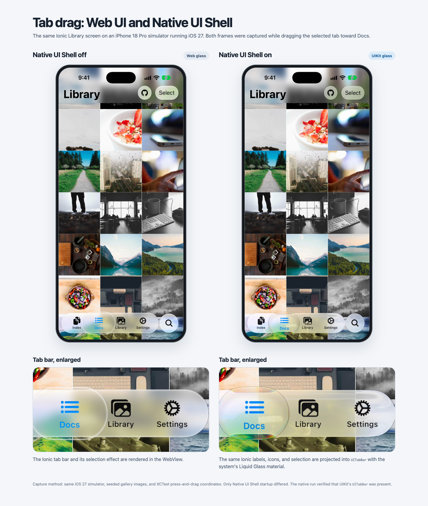

# Ionic Theme and Capacitor Native UI

> **Upcoming release:** this branch documents the new two-package setup. `@rdlabo/capacitor-native-ui` has not had its first npm release yet. Use the [preview package instructions](packages/capacitor-native-ui/README.md#try-the-unreleased-packages) to try this code, or follow the [published iOS 27 v1.2.1 guide](https://github.com/rdlabo-dev/ionic-theme-ios27/tree/ios27-v1.2.1) for the current npm release. Do not mix the two sets of imports.

Bring the iOS look to your Ionic app, or add native controls to your Capacitor app while keeping Web content, routing, and application state.

**[Try the Ionic 9 demo](https://ionic-theme-ios27.rdlabo.dev/) · [Try the Ionic 8 demo](https://ionic8-theme-ios27.rdlabo.dev/)**

  
  
  

## Give your Web UI the iOS look

**[@rdlabo/ionic-theme-ios27](packages/theme-ios27/README.md)** brings Liquid Glass styling, light and dark appearances, and coordinated animations to Ionic toolbars, tabs, lists, buttons, search, and overlays. Use it on its own to style your Web UI.

[Get started with the theme](packages/theme-ios27/docs/setup.md) · [Explore theme features](packages/theme-ios27/docs/features.md)

## Bring supported controls into native UI

**[@rdlabo/capacitor-native-ui](packages/capacitor-native-ui/README.md)** projects supported Ionic controls into UIKit and SwiftUI on iOS. Your existing markup supplies their labels, icons, and state; native actions flow back to your Ionic components. Page content and routing stay in the WebView.

Keep your existing Web appearance or pair it with the iOS theme. Native UI is opt-in and currently a preview; unsupported controls and browsers retain Web presentation. On Android, standard controls stay on the Web; experimental app-local extensions can render with Jetpack Compose. Your app or theme owns Web layout and styling.

[Get started with Native UI](packages/capacitor-native-ui/docs/setup.md) · [Supported controls](packages/capacitor-native-ui/docs/native-ui.md#supported-markup)

The same Library screen with Native UI off and on, captured while dragging the selected tab:

## Choose what your app needs

| Your goal | Start here |
| --- | --- |
| Style your Ionic Web UI | [Set up the theme](packages/theme-ios27/docs/setup.md) |
| Render Ionic controls natively with your existing Web appearance | [Set up Native UI](packages/capacitor-native-ui/docs/setup.md) |
| Use native buttons without Ionic | [HTML setup](packages/capacitor-native-ui/docs/framework-independent.md) |
| Add only a vertical rail to an Ionic app | [Vertical Bars setup](packages/theme-ios27/docs/iphone-duo-with-original-theme.md) |
| Add custom SwiftUI or Compose content | [App-local extensions (experimental)](packages/capacitor-native-ui/docs/native-ui-extensions.md) |

Already using the iOS theme? [Add Native UI to your theme](packages/theme-ios27/docs/add-native-ui.md) as your next step.

Both packages support Ionic 8.8.1 or later within Ionic 8 or 9. Native UI requires Capacitor 8; see its setup guide for supported iOS environments.

## Explore further

- Maintainers: [release both packages](docs/releasing.md).

- [iPhone Duo layout](packages/theme-ios27/docs/iphone-duo.md) · [Vertical Bars with an existing theme](packages/theme-ios27/docs/iphone-duo-with-original-theme.md).
- [Theme migration](packages/theme-ios27/docs/migration.md) · [Native UI migration](packages/capacitor-native-ui/docs/migration.md).

Use standard native buttons without Ionic through the [plain HTML adapter](packages/capacitor-native-ui/docs/framework-independent.md), or keep Ionic markup and enable only [Vertical Bars](packages/capacitor-native-ui/docs/configuration.md). Both use the same native renderers.
